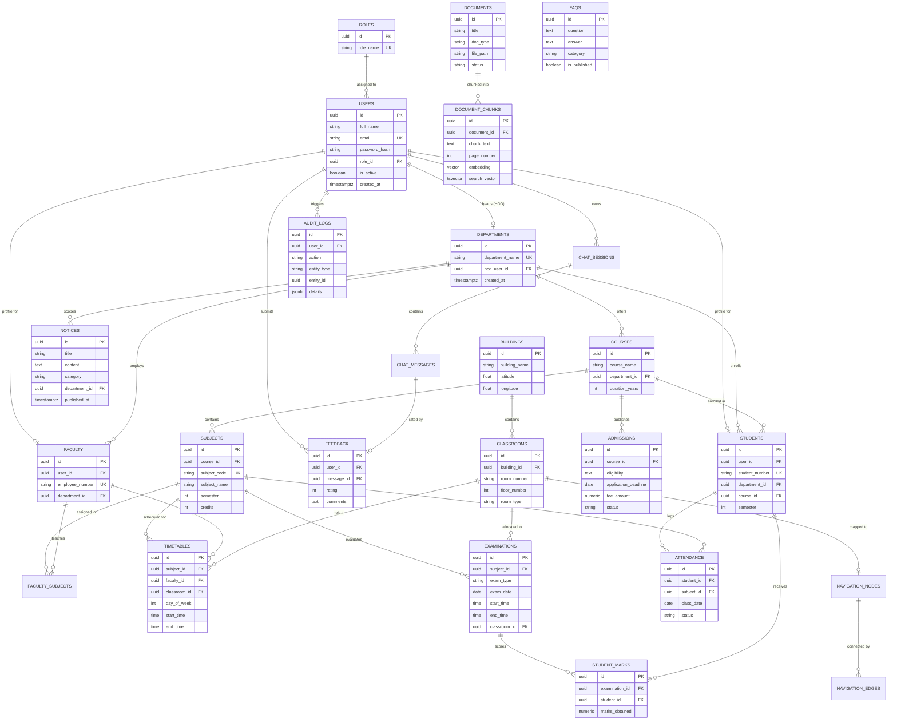

# 🗄️ Database Architecture & Entity-Relationship (ER) Documentation

> **University Smart Assistant (Uni-Assistant)**  
> **Database Engine:** PostgreSQL 16 with `pgvector` Extension  
> **Migration Management:** Incremental SQL migrations in `db/migrations/` tracked by `schema_migrations`.

---

## 1. Compliance with Assignment Requirements

As specified in **Section 5 (Database Requirements, Page 8)** of the assignment document, the system maintains a fully normalized relational schema encompassing all **18 mandatory core tables** plus extended infrastructure tables for campus spatial wayfinding, FAQs, and incremental migrations:

| Mandatory Table | Implemented Table Name | Description |
| :--- | :--- | :--- |
| 1. Users | `users` | User credentials, emails, names, active flags |
| 2. Roles | `roles` | System roles (`student`, `teacher`, `hod`, `admin`, `applicant`, `visitor`) |
| 3. Departments | `departments` | Academic departments and designated HOD user references |
| 4. Students | `students` | Student profiles, student numbers, semester, department, and course |
| 5. Faculty | `faculty` | Faculty records, employee numbers, and department links |
| 6. Courses | `courses` | Academic programs (BCA, MCA, BBA) with duration and department |
| 7. Admissions | `admissions` | Admission programs, eligibility, fees, deadlines, and status |
| 8. Classrooms | `classrooms` | Rooms, lecture halls, labs, floor numbers, and building references |
| 9. Buildings | `buildings` | Campus physical blocks, names, and GPS coordinates |
| 10. Timetables | `timetables` | Day-of-week class schedules, time slots, teachers, rooms |
| 11. Subjects | `subjects` | Course curriculum subjects, codes, semesters, and credits |
| 12. Notices | `notices` | University announcements with department scoping |
| 13. Knowledge Documents | `documents` | Source documents (PDF/DOCX) indexed for hybrid RAG |
| 14. Document Chunks | `document_chunks` | 768-dim vector embeddings + full-text search tsvectors |
| 15. Chat Sessions | `chat_sessions` | Conversation sessions linked to authenticated users |
| 16. Chat Messages | `chat_messages` | Individual message turns, roles, and timestamps |
| 17. Feedback | `feedback` | Thumbs up (5) / Thumbs down (1) ratings per message |
| 18. Audit Logs | `audit_logs` | Security and administrative audit trail |
| *Extended: FAQs* | `faqs` | Knowledge base Q&As and institutional guidelines |
| *Extended: Navigation* | `navigation_nodes`, `navigation_edges` | Campus spatial graph for Dijkstra routing |
| *Extended: Faculty Subjects*| `faculty_subjects` | Many-to-many teaching assignments |
| *Extended: Marks & Attendance*| `student_marks`, `attendance`, `examinations` | Academic evaluations and attendance logging |

---

## 2. Entity-Relationship (ER) Diagram



---

## 3. Data Dictionary

### 3.1. Authentication & Users
- **`roles`**: Defines system authorization roles: `student`, `teacher`, `hod`, `admin`, `applicant`, `visitor`.
- **`users`**: Master user authentication table. Passwords stored using `bcrypt` (cost factor 10). `is_active` boolean allows instant account deactivation without breaking relational integrity.
- **`audit_logs`**: Immutable record of significant user and administrative events (logins, notice creations, room allocations, security denials).

### 3.2. Institutional & Academic Structure
- **`departments`**: Academic departments (e.g. Computer Science, Management). `hod_user_id` enforces 1-to-1 HOD assignments.
- **`courses`**: Academic degrees (BCA, MCA, BBA) tied to their parent department.
- **`subjects`**: Curriculum units with unique codes (`BCA401`), associated semester, and credit ratings.
- **`faculty`**: Academic teachers linked to `users(id)` and `departments(id)`.
- **`faculty_subjects`**: Many-to-many mapping between faculty and taught subjects.
- **`students`**: Enrolled students with semester level, department, and course links.
- **`student_enrollments`**: Active subject enrollments for each student.

### 3.3. Timetable & Examinations
- **`buildings`**: Physical campus blocks with GPS coordinates (`latitude`, `longitude`).
- **`classrooms`**: Indoor venues, lecture rooms, computer labs, and seminar halls.
- **`timetables`**: Weekly recurring class schedules with `day_of_week` (1 = Monday, 7 = Sunday) and time slots.
- **`examinations`**: Assessment events (`Internal Assessment`, `Mid-Semester Exam`, `Special Practical Assessment`). `classroom_id` is nullable to allow scheduling prior to venue allocation.
- **`student_marks`**: Evaluation scores achieved by students in examinations. Unique constraint `(examination_id, student_id)`.
- **`attendance`**: Daily session attendance (`present`, `absent`, `leave`). Unique constraint `(student_id, subject_id, class_date)`.

### 3.4. Admissions & Information Bulletin
- **`admissions`**: Official admission parameters for degree programs. When fields like `application_deadline` or `fee_amount` are undetermined, they are strictly kept `NULL` to prevent AI fabrication.
- **`notices`**: Campus-wide and department-scoped bulletins (`department_id` foreign key).
- **`faqs`**: Frequently asked questions with publish status toggles (`is_published`).

### 3.5. Campus Spatial Navigation Graph
- **`navigation_nodes`**: Graph vertices representing campus landmarks, rooms, entrances, elevators, stairs, and QR placards (`node_type`). Linked to `classroom_id` where applicable.
- **`navigation_edges`**: Bidirectional graph edges with physical walking distances (`distance_meters`) and `is_accessible` flags (step-free wheelchair routing).

### 3.6. Knowledge Base & Hybrid RAG
- **`documents`**: Source university documents (PDF, DOCX) uploaded by Administrators with indexing states (`pending`, `indexed`, `failed`).
- **`document_chunks`**: Document text chunks (1,000 chars with 150-char overlap) retaining exact `page_number`. Contains 768-dimensional vector embeddings (`embedding vector(768)`) and pre-computed PostgreSQL search vectors (`tsvector`).

### 3.7. Conversational Sessions & Feedback
- **`chat_sessions`**: User chat threads with timestamps.
- **`chat_messages`**: Conversational turns (`user` and `assistant`) with message contents.
- **`feedback`**: User feedback ratings (5 = Thumbs Up, 1 = Thumbs Down) tied uniquely per `(user_id, message_id)`.

---

## 4. Indexing & Optimization Strategy

1. **Vector Cosine Operations (HNSW Index)**:
   ```sql
   CREATE INDEX idx_chunks_embedding ON document_chunks USING hnsw (embedding vector_cosine_ops);
   ```
   Enables ultra-fast approximate nearest neighbor (ANN) vector search across thousands of document chunks.

2. **Full-Text Keyword Search (GIN Index)**:
   ```sql
   CREATE INDEX idx_chunks_search_vector ON document_chunks USING gin (search_vector);
   ```
   Powers Reciprocal Rank Fusion (RRF) keyword matching in tandem with vector search.

3. **High-Frequency Relational Indexes**:
   - `idx_attendance_student`: `attendance(student_id, subject_id)`
   - `idx_marks_student`: `student_marks(student_id)`
   - `idx_exams_date`: `examinations(exam_date)`
   - `idx_timetable_faculty`: `timetables(faculty_id, day_of_week)`
   - `idx_notices_dept`: `notices(department_id)`
   - `idx_sessions_user`: `chat_sessions(user_id)`
   - `idx_messages_session`: `chat_messages(session_id)`
