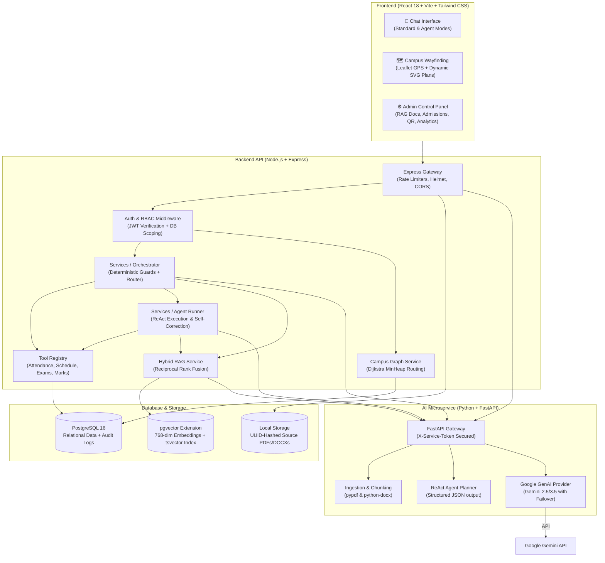

# 🎓 University Smart Assistant (Uni-Assistant)

> **A privacy-first, role-aware institutional AI assistant and campus wayfinding system for universities.**  
> Built with React 18, Node.js/Express, Python/FastAPI, PostgreSQL (`pgvector`), and Google Gemini.

[](https://react.dev/)
[](https://nodejs.org/)
[](https://fastapi.tiangolo.com/)
[](https://github.com/pgvector/pgvector)
[](https://ai.google.dev/)

---

## 📖 Overview

The **University Smart Assistant** is a unified campus operating portal designed for students, teachers, department heads, administrators, applicants, and visitors. It bridges traditional institutional databases with modern conversational AI, delivering verified personal records, academic explanations, administrative document search, and campus walking navigation while strictly upholding user privacy and zero-trust data isolation.

### 📚 Official Deliverables & Technical Documentation
- [**`SYSTEM_DESIGN.md`**](SYSTEM_DESIGN.md): Software Requirements Specification (SRS), High-Level Design (HLD), and Low-Level Design (LLD).
- [**`DATABASE.md`**](DATABASE.md): Complete Relational Database Documentation, Data Dictionary, and Mermaid Entity-Relationship (ER) Diagram.
- [**`SECURITY_REPORT.md`**](SECURITY_REPORT.md): Formal Security & Verification Report covering Mandatory Security Tests, Zero-Trust Student Data Isolation, and HOD Boundary Tests.
- [**`postman_collection.json`**](postman_collection.json): Production-grade Postman collection for evaluators, pre-configured with Authentication, AI Chat, Academic Records, HOD, Teacher, Admin, Navigation, and Security Test Scenarios.
- [**`ARCHITECTURE.md`**](ARCHITECTURE.md): Technical Architecture Walkthrough, Hybrid RAG with Reciprocal Rank Fusion, and ReAct Planning Engine.

---

## ⚡ Key Capabilities

### 1. 🤖 Dual-Mode Conversational Intelligence
- **Standard Mode (Fast Single-Turn Router + Hybrid RAG)**:  
  Classifies user questions into operational database tools (attendance, timetable, exams, marks) or searches approved university documents using hybrid vector + keyword search.
- **Autonomous Agent Mode (ReAct Planning Loop)**:  
  Multi-step planning and tool execution. Allows users to ask complex compound questions (e.g., *"What is my attendance, which subjects am I at risk in, and where is my next class?"*).
- **Hallucination & Number Grounding Guard**:  
  An automated self-correction checker verifies that all figures in the agent's draft originate strictly from verified database records. If ungrounded numbers are detected, the agent triggers a self-repair pass.
- **Full Traceability**:  
  Every agent step, thought, tool latency, and self-check action is surfaced in an interactive execution disclosure.

### 2. 🔒 Zero-Trust Privacy & RBAC
- **Strict Role Isolation**: Distinct, enforced tool sets for `student`, `teacher`, `hod`, `admin`, `applicant`, and `visitor`.
- **Identity Integrity**: User identity is derived exclusively from verified JWT tokens and fresh database lookups. Endpoints never accept an untrusted `student_id` parameter.
- **Deterministic Cross-Student Guard**: Prompts attempting to inquire about other students or faculty are blocked *before* reaching any LLM or database tool.
- **Timing Attack Defense**: Password comparison uses constant-time bcrypt hashing even when accounts do not exist.

### 3. 🗺️ Campus Wayfinding & Dynamic Floor Plans
- **Dijkstra Shortest-Path Engine**: Pure in-memory graph routing with a binary MinHeap implementation.
- **Multi-Level Navigation**: Computes turn-by-turn indoor and outdoor steps (walking distances, stairs, and elevators).
- **Step-Free Accessibility Mode**: Automatically routes via elevators for wheelchair accessibility.
- **Interactive SVG Floor Plans**: Dynamic architectural vector blueprint rendering room highlights, path polylines, and waypoint stops.
- **Physical QR Code Support**: Scan door QR placards (e.g. `QR-GATE`, `QR-ROOM-201`) to immediately set origin location.

### 4. 📚 Hybrid Document Ingestion & RAG
- **Institutional Knowledge Base**: Ingests official syllabi, handbooks, hostel/library policies, and examination procedures.
- **Format Integrity**: Strict magic-byte validation for uploaded PDF and DOCX files.
- **Sentence-Window Chunking**: Splits documents into 1,000-character windows with 150-character overlap while strictly preserving page boundaries for exact citations.
- **Reciprocal Rank Fusion (RRF)**: Merges PostgreSQL full-text search (`tsvector` with BM25-style ranking) and `pgvector` 768-dimensional cosine similarity.

### 5. ⚙️ Administrative Command Center
- **Knowledge Base Lifecycle**: Upload, index, approve, re-index, and delete documents with live indexing telemetry.
- **Course Admissions**: Real-time management of eligibility criteria, deadlines, fees, and contact details.
- **Campus Directory & Placards**: Manage building geolocations, room keywords, and batch-print physical QR codes.
- **System Telemetry**: 14-day user query volume, intent distribution charts, and security denial logs.

---

## 🏛️ System Architecture



---

## 📁 Repository Layout

```
uni-assistant/
├── ai-service/              # Python FastAPI microservice
│   ├── app/
│   │   ├── main.py          # API route definitions and schemas
│   │   ├── config.py        # Settings and environment bindings
│   │   ├── ingest.py        # PDF/DOCX parsing and sentence-window chunking
│   │   ├── prompts.py       # Prompt engineering & system instructions
│   │   └── providers/       # LLM provider abstractions (Gemini + fallbacks)
│   └── tests/               # Pytest suite with mock LLM provider (no API key needed)
├── backend/                 # Node.js + Express API server
│   ├── src/
│   │   ├── app.js           # Server middleware (Helmet, CORS, Rate limits)
│   │   ├── config.js        # Environment validation
│   │   ├── db.js            # PostgreSQL connection pool
│   │   ├── audit.js         # Security & action auditing
│   │   ├── middleware/      # JWT authentication and RBAC guards
│   │   ├── routes/          # Express route handlers (/auth, /chat, /campus, etc.)
│   │   ├── services/        # Orchestrator, Agent loop, Campus graph, RAG retrieval
│   │   └── tools/           # Function registry exposed to the AI assistant
│   ├── scripts/             # Database migration, seed data, and agent demo scripts
│   └── tests/               # Automated test suites (security, RBAC, campus, RAG)
├── db/
│   └── migrations/          # Incremental SQL migrations (Postgres + pgvector)
│       ├── 001_core_schema.sql
│       ├── 002_rag_admin.sql
│       └── 003_campus_navigation.sql
├── frontend/                # React 18 + Vite SPA with Tailwind CSS
│   └── src/
│       ├── App.jsx          # Root component & view router
│       ├── api.js           # API client layer
│       ├── pages/           # Chat, Campus Navigation, Admin, Login
│       └── components/      # MessageBubble, Icons, AgentTrace, TypingIndicator
└── sample-docs/             # Benchmark university documents for RAG indexing
```

---

## 🚀 Quick Start Guide

### Prerequisites
- [Docker & Docker Compose](https://www.docker.com/)
- [Node.js](https://nodejs.org/) (v18 or higher)
- [Python](https://www.python.org/) (v3.11 or higher)
- [Google Gemini API Key](https://aistudio.google.com/)

---

### Step 1: Environment Configuration
Copy `.env.example` to `.env` in the project root:

```bash
cp .env.example .env
```

Open `.env` and set your credentials:
```ini
DB_USER=uni_admin
DB_PASSWORD=your_password
DB_NAME=uni_assistant
JWT_SECRET=your_long_random_jwt_secret
AI_SERVICE_TOKEN=your_long_random_service_token
GEMINI_API_KEY=your_gemini_api_key_here
```

---

### Step 2: Start the PostgreSQL + pgvector Database
Start the PostgreSQL container (migrations in `db/migrations/` run automatically on initial startup):

```bash
docker compose up -d db
```

Verify that the container is healthy:
```bash
docker compose ps
```

---

### Step 3: Start the Python AI Microservice

```bash
cd ai-service

# Create and activate virtual environment
python -m venv .venv
source .venv/bin/activate       # On Windows: .venv\Scripts\activate

# Install dependencies
pip install -r requirements.txt

# Start FastAPI server
uvicorn app.main:app --reload --port 8000
```
*API documentation will be available at [http://localhost:8000/docs](http://localhost:8000/docs).*

---

### Step 4: Seed the Database & Start the Backend

Open a new terminal window:

```bash
cd backend

# Install dependencies
npm install

# Seed demo users, courses, timetable, attendance, and campus graph
npm run seed

# Start the Express server
npm start
```
*The backend API will run on [http://localhost:4000](http://localhost:4000).*

---

### Step 5: Start the Frontend Application

Open a new terminal window:

```bash
cd frontend

# Install dependencies
npm install

# Start Vite dev server
npm run dev
```
*Open your browser at [http://localhost:5173](http://localhost:5173).*

---

## 👥 Pre-Configured Test Accounts

All demo accounts share the password: `Password@123`

| Persona | Role | Email | Description |
|---|---|---|---|
| **System Admin** | `admin` | `admin@uni.test` | Full administrative control, RAG manager, admissions editor, analytics |
| **Dr. Meera Sharma** | `hod` | `hod@uni.test` | Head of Computer Science Department |
| **Prof. Rahul Verma** | `teacher` | `teacher@uni.test` | Faculty member (Database Systems & Python) |
| **Riya Patel** | `student` | `student1@uni.test` | BCA Semester 4 student (Room 201) |
| **Aman Singh** | `student` | `student2@uni.test` | BCA Semester 4 student |

---

## 🧪 Testing & Verification

### Backend Automated Test Suite
Verifies privacy guarantees, student isolation, agent tool schemas, Dijkstra navigation, and hybrid RAG fusion:

```bash
cd backend
npm test
```

### AI Service Tests (No API Key Required)
Runs unit and integration tests using a local mock provider:

```bash
cd ai-service
pytest
```

### Frontend Production Build Test
Verifies JSX syntax, module resolution, and CSS bundle generation:

```bash
cd frontend
npm run build
```

### Live Agent CLI Demonstration
Run multi-step reasoning questions against your running stack from the terminal:

```bash
cd backend
node scripts/agentDemo.js student1@uni.test
```

---

## 🛡️ Security & Privacy Guarantees

1. **Deterministic Identity Resolution**: The user's role and user ID are loaded fresh from PostgreSQL using the verified JWT `sub` claim. No request parameter can override caller identity.
2. **Student Privacy Fence**: The database services in `backend/src/services/records.js` do not accept external student IDs; all queries are inherently scoped to `WHERE user_id = $1`.
3. **Cross-User Mention Filter**: Any prompt containing the name or ID of another student/teacher is caught deterministically and refused before contacting the AI model.
4. **Prompt Injection Hardening**: All tool observations and document excerpts are encapsulated within isolated XML-style tags (`<data>`, `<observation>`). System instructions explicitly order the model to treat user inputs and retrieved data as untrusted text.
5. **Constant-Time Cryptography**: Password verification employs a precomputed dummy hash for non-existent users, preventing username enumeration through timing analysis.
6. **Hallucination Containment**: The ReAct agent verifies every numeric token in its final draft against the retrieved tool observations.

---

## 📄 License

This project is licensed under the [MIT License](LICENSE).
