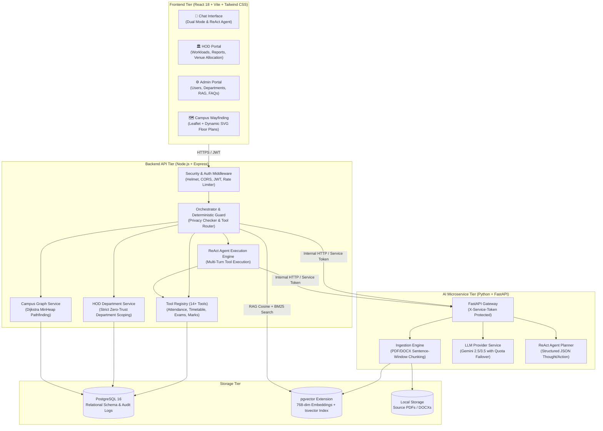
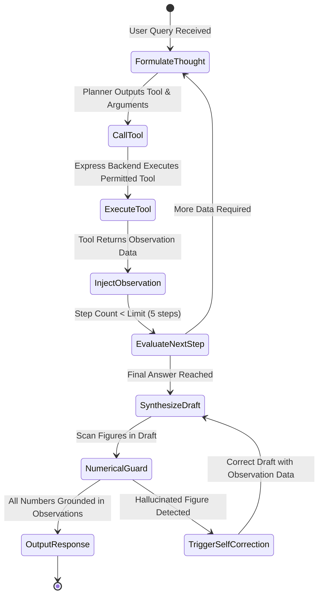
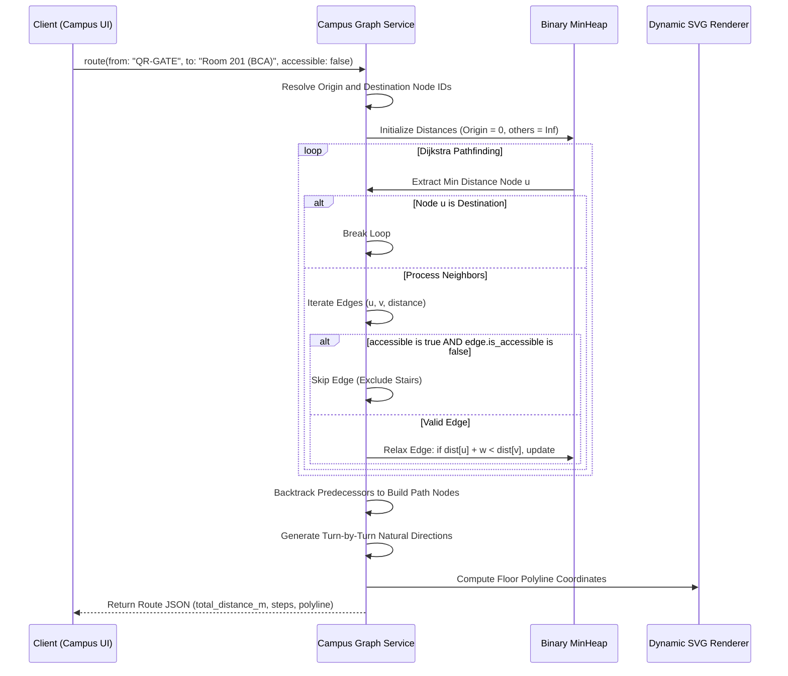
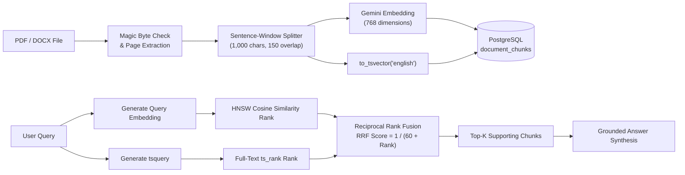

# 📐 System Design Document: SRS, HLD & LLD

> **Project Title:** AI-Powered University Smart Assistant (Uni-Assistant)  
> **Technologies:** React 18, Node.js / Express.js, Python / FastAPI, PostgreSQL 16 (`pgvector`), Google Gemini LLM  
> **Deliverable Scope:** Software Requirements Specification (SRS), High-Level Design (HLD), and Low-Level Design (LLD).

---

## Part 1: Software Requirements Specification (SRS)

### 1.1. Functional Requirements

- **FR-1: AI Chatbot Development (Task 1)**: Interactive natural-language interface with session persistence, follow-up context management, typing indicators, and conversation reset.
- **FR-2: University Admission Guidance (Task 2)**: Verified program eligibility, fee structures, application deadlines, and admission procedures from database records with strict anti-hallucination controls.
- **FR-3: Campus & Indoor Navigation (Task 3)**: Interactive Leaflet campus map, SVG architectural floor plans, turn-by-turn indoor directions, wheelchair-accessible routing, and physical QR placard origin identification.
- **FR-4: General Education Assistant (Task 4)**: Educational question answering across computer science, engineering, and mathematics; simple and detailed explanation modes; automated MCQ and assignment generation.
- **FR-5: Student Academic Assistant (Task 5)**: Personal class timetables, attendance percentages, upcoming examinations, personal marks, and administrative guidance with zero-trust privacy boundaries.
- **FR-6: Teacher Academic Assistant (Task 6)**: Teaching schedules, assigned curriculum subjects, instant classroom locator ("Where is my next classroom?"), lesson plan structuring, and automated test question drafting.
- **FR-7: HOD Department Assistant (Task 7)**: Department overview, faculty workload distribution, course curriculum, departmental schedule & examinations, pending bottlenecks (missing rooms, ungraded evaluations), aggregate-only analytics, printable executive reports, CSV data downloads, and live venue allocation.
- **FR-8: University Administration Assistant (Task 8)**: Retrieval of official university policies, fee payment regulations, hostel/transport guidelines, and student grievance procedures via Hybrid RAG.
- **FR-9: Administrative Control Center (Task 9)**: Knowledge base lifecycle (uploading PDF/DOCX, sentence-window chunking, vector indexing), user account management (creation, role switching, deactivation), department & faculty assignment, FAQ publisher, and system telemetry monitoring.

### 1.2. Non-Functional Requirements

- **NFR-1 (Zero-Trust Security & Privacy)**: User identity derived exclusively from validated JWTs and fresh database queries. Prompts inquiring about other students are rejected before reaching any LLM.
- **NFR-2 (Anti-Hallucination & Numerical Grounding)**: The system disallows inventing missing dates or fees. An automated ReAct self-correction guard verifies that all numerical figures in assistant drafts originate from database observations.
- **NFR-3 (High Availability & Failover)**: Dual-model LLM failover handles API rate limits (HTTP 429) automatically.
- **NFR-4 (Performance & Latency)**: Sub-second response times for standard database tool queries; sub-10ms path computation for campus Dijkstra navigation.
- **NFR-5 (Accessibility)**: Full support for step-free indoor routing (avoiding stairs in favor of elevators) and WCAG-compliant UI color contrast.

---

## Part 2: High-Level Design (HLD)

### 2.1. System Topology & Microservice Architecture



---

## Part 3: Low-Level Design (LLD)

### 3.1. ReAct Autonomous Agent Planning Loop

When a user asks complex compound questions (e.g. *"What is my attendance, which subjects am I at risk in, and where is my next class?"*), the system activates the autonomous ReAct agent loop:



#### Numerical Grounding Guard Algorithm:
1. Extract all numeric tokens (integers, percentages, decimals) from the agent's drafted answer.
2. Filter out conversational numbers (e.g., "1st", "2026", step numbers).
3. Verify that every remaining number exists verbatim in the tool observation payload.
4. If an ungrounded number is detected, trigger an automated repair prompt passing the ungrounded tokens and raw observations to produce a corrected response.

---

### 3.2. Campus Spatial Wayfinding Engine (Dijkstra with MinHeap)

Campus navigation computes optimal walking routes between any two campus locations, rooms, or scanned QR placards:



---

### 3.3. Hybrid Document Ingestion & RAG (Reciprocal Rank Fusion)

The hybrid RAG pipeline ensures that institutional documentation is retrieved accurately using both semantic vector search and exact keyword matching:



---

### 3.4. Zero-Trust RBAC & Department Data Isolation

Security is enforced at the database query level to prevent horizontal privilege escalation:

1. **Authentication Verification**: All requests pass through `authenticate`, verifying the signature and expiration of the JWT token.
2. **Fresh User Resolution**: The user's role and account status (`is_active = true`) are re-verified on every request.
3. **Department Scoping**:
   - For all HOD operations, `getHodDepartment(userId)` resolves `department_id` from `departments.hod_user_id = $1`.
   - Every subsequent query (`SELECT`, `INSERT`, `UPDATE`) joins `courses` and `departments` using the resolved department ID:
     ```sql
     SELECT e.id FROM examinations e
       JOIN subjects s ON s.id = e.subject_id
       JOIN courses c ON c.id = s.course_id
      WHERE e.id = $1 AND c.department_id = $resolvedDepartmentId
     ```
   - This ensures that a Computer Science HOD cannot view, schedule, or allocate venues for Management examinations under any circumstances.
